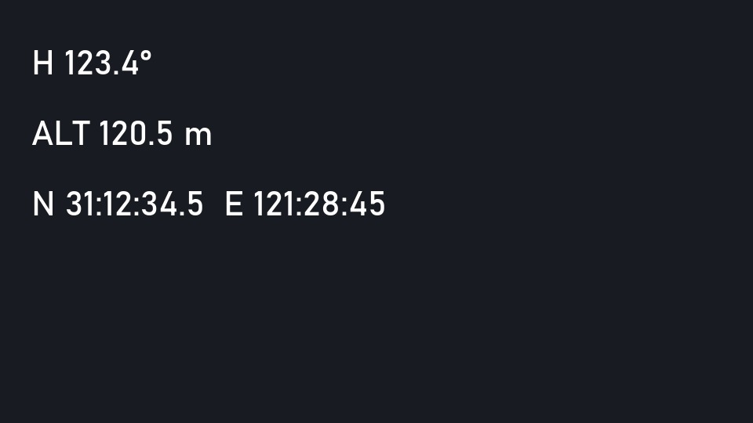

# OCR_reader —— 视频 OSD 参数实时提取

从含 OSD 参数叠加显示（On-Screen Display）的视频/图片中，实时提取文字数值（高度、电压、速度、时间、相机参数等），并在播放界面上同步显示。

**零模型依赖**：不使用任何神经网络 OCR 引擎，纯传统图像处理（Otsu 二值化 → 连通域切字 → 模板匹配 + 字符缓存 + 逻辑修正），CPU 上毫秒级识别。



## 特性

- **双程序工作流**：标注工具（一次标定 ROI + 标签 + 单位）→ 实时提取（播放即识别）
- **一机一模板**：ROI、逻辑规则、标签格式全部打包在一个模板 json 里，换设备换模板
- **逻辑分析模块**：单位在数字后、冒号白名单、时间自动分组、小数全局唯一（突出间隔判定 + 白像素校验）、标签格式语言（`?` = 一位数字，`*` = 不限位数）
- **字体自适应**：模板库（含 Bahnschrift 等 DIN 系字体）+ 从素材自采集字符模板（像素级匹配 0.9999+）
- **性能设计**：变化门控（画面没变不重复识别）、量化缓存、向量化模板匹配（分组预归一化 + 矩阵批量相关）、读帧/识别双线程解耦
- **开箱即用**：PyInstaller 打包双 exe，目标机器零依赖

## 快速开始

**方式一（发布版，推荐）**：`dist/` 下两个 exe + `使用说明.txt`，Windows 10/11 x64 直接双击。

**方式二（源码）**：

```bash
pip install -r requirements.txt        # opencv-python pillow numpy（rapidocr 可选）
python src/roi_annotator.py            # 程序 1：标注 ROI
python src/realtime_ui.py              # 程序 2：实时提取
```

使用流程见 [doc/使用流程.md](doc/使用流程.md)。

## 工作原理

```
视频/图片 → 抽帧(间隔采样) → ROI裁剪(模板) → 变化门控 → 预处理(灰度/放大/Otsu)
→ 连通域切字(粘连切分) → 模板匹配(缓存+向量化) → 逻辑分析(单位/冒号/小数/格式)
→ 面板+画面叠加输出
```

## 目录结构

```
OCR_reader/
├─ src/                     # 源码
│  ├─ roi_annotator.py      # 程序1：ROI 标注工具（含字体采集/逻辑设置/标签格式）
│  ├─ realtime_ui.py        # 程序2：实时提取 UI
│  ├─ ocr_engine.py         # 传统模板匹配引擎（切字/匹配/缓存/粘连处理）
│  ├─ logic_analyzer.py     # 逻辑分析模块（规则可配，随模板保存）
│  ├─ roi_template.py       # 模板读写与缩放
│  └─ paths.py              # 打包/源码双形态路径基座
├─ doc/                     # 需求分析 / 方案选择 / 使用流程 / 开发历程
├─ samples/                 # 素材（仓库只放合成演示图，真实素材自备）
├─ 不足说明.md              # 项目不足与边界
├─ build.bat                # PyInstaller 打包脚本
└─ requirements.txt
```

## 模板与配置

ROI 模板 json 结构（标注工具生成）：

```json
{
  "source_width": 1918, "source_height": 1078,
  "logic": {"colon_labels": ["录制时间", "飞行时间", "相机参数"], "decimal_gap_ratio": 0.4},
  "formats": {"飞行时间": ["??:??"], "相机参数": ["*:*"]},
  "rois": [{"name": "海拔高度", "unit": "m", "with_unit_letters": true, "x": 895, "y": 158, "w": 216, "h": 63}]
}
```

## 打包发布

```bat
build.bat    # 需先 pip install pyinstaller
```

## License

MIT © 2026 龚界霖

详见 [doc/开发历程.md](doc/开发历程.md)（完整演进与踩坑记录）、[不足说明.md](不足说明.md)。
